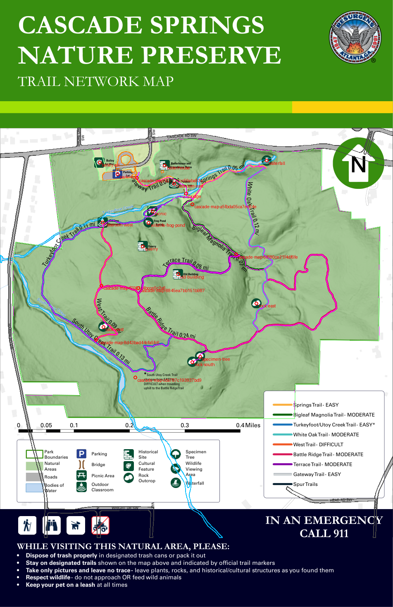

# Georeferenced map layers (PR 3)

This slice replaces the hand-drawn preserve outline with the supplied PDF's
boundary and adds water, natural areas, road/building footprints and reconciled
landmarks. It is stacked on [PR 2 #30](https://github.com/ssomalinga3/CX_3803_JIDCC_6342_TSA/pull/30).
The [stack plan](../../docs/tasks/gis-data-integration-plan.md#7-pr-3-pdf-geographic-layers)
and [review controls](pdf-map-review.json) define the extraction scope.

## Reproduce and import

Use the [locked GIS environment](README.md#reproduce-verification-and-inspection)
from the workspace root. Originals remain unchanged; Downloads is not needed.

```sh
uv run --locked --project tools/gis python tools/gis/convert_pdf_map.py
pnpm exec prettier --write data/cascade-springs-gis/pdf-map.geojson
uv run --locked --project tools/gis python tools/gis/convert_pdf_map.py --check
uv run --locked --project tools/gis python -m unittest discover -s tools/gis -p 'test_*.py'
# Refresh durable review evidence after inspecting changed sources/tools:
uv run --locked --project tools/gis python tools/gis/convert_pdf_map.py --check --evidence
pnpm --dir backend db:import:source
pnpm --dir backend db:import:pdf
pnpm --dir backend db:import:boundary
```

`db:import:source` replaces the seven selected layers together: 36 supplied trail
segments and 33 context/landmark features. `db:import:pdf` replaces only the six
PDF/reconciled layers, preserving trails. The legacy `db:import:boundary` validates
its archived input and selects the same six PDF layers. None can restore the
hand-drawn boundary or duplicate waterfall. All three use advisory lock
**(6342, 2)**, shared with the trail-only importer. Only these owned layer IDs are
replaced; synthetic fixtures, unrelated layers and the original source files stay
intact. Runtime validation precedes replacement; PostGIS topology checks and ID
conflicts roll back the entire transaction, including metadata and stale removal.
No migration or physical GIS table was added.

Set `CASCADE_DB_PORT` to the intended local database (default 55432); an explicit
`DATABASE_URL` overrides it. `test:fresh` creates and removes its own disposable
loopback database and replays all selected/legacy commands.

## Layer and identity handoff

| Layer ID                    | Kind         | Geometry   |            Features |
| --------------------------- | ------------ | ---------- | ------------------: |
| `cascade-map-trails`        | trail        | LineString | 36 (unchanged PR 2) |
| `cascade-map-boundary`      | boundary     | Polygon    |                   1 |
| `cascade-map-water`         | water        | Polygon    |                   2 |
| `cascade-map-natural-areas` | natural_area | Polygon    |                   2 |
| `cascade-map-roads`         | road         | Polygon    |                   3 |
| `cascade-map-buildings`     | building     | Polygon    |                   3 |
| `cascade-map-landmarks`     | landmark     | Point      |                  22 |

These are connected extracted polygons after union, not counts of source GIS
objects or paint commands. Water polygons retain the reviewed South Utoy Creek and Turkeyfoot Creek names.
Roads are **footprints**, not inferred centerlines.
Buildings are retained according to their PDF content group, without inferring
occupancy/use. The road footprint includes a hole; disconnected parts are separate
features. All layers have null pillars and `isDemo: false`; those flags do not
establish accuracy, licensing, ownership or safety approval.

Context IDs are `csnp-pdf-<kind>-<three-digit component>` in normalized page-bound
order. Symbol IDs are `csnp-pdf-poi-<review symbol>`. These are versioned extraction
identities, not invented ArcGIS IDs. Source hash, group and drawing-path references
or symbol page anchor/bbox remain in properties. A changed source must review
component identity before replacement. Seven unmatched My Maps annotations retain
their original IDs/coordinates and receive `landmark_kind: source_annotation` and
an explicit “(My Maps annotation)” label. No new geometry is traced by hand.

## Registration and extraction

The PDF contains one `/GEO` viewport with four normalized `/LPTS` corners and
latitude/longitude `/GPTS` anchors rounded to five decimal degrees. The embedded
WKT specifies spherical Mercator with radius 6378137 m and meter units. It is
read and checked against the preserved inspection record; its auxiliary-sphere
datum name does not resolve to an EPSG identifier in pyproj. Do not silently
substitute the terrain grid's unrelated datum.

PDF page coordinates have a lower-left origin; PyMuPDF drawing coordinates use
an upper-left origin. The converter flips the viewport vertically using the
2448-point page height, projects geographic anchors into the embedded CRS,
interpolates **projected easting/northing**, then transforms to WGS84
longitude/latitude. Coordinates use ten decimal degrees for reproducibility,
not as an accuracy claim. Geographic viewport bounds are approximately
`[-84.48437, 33.71163, -84.47412, 33.72051]`.

Only the reviewed named geographic groups are eligible. Legend, scale bar,
attribution, labels, basemap, north arrow, page furniture and PDF trail strokes
are excluded from feature publication. [Geographic label evidence](review/pdf-map-labels.json)
retains road, stream and POI text fragments with page boxes; fragmented or offset
road labels are not guessed into names for connected road polygons. Fourteen raster placements belong to the
`Points of Interest` group; the bridge's six vector pieces produce one marker.
Markers use bounding-box centers. Review labels and map symbol types come from
visual inspection, not guessed nearest text. Cartographic anchors can be displaced
and a 40-point icon spans roughly 24 ground meters.

Closed source subpaths are required. Even-odd compound paths preserve holes and
islands; unsupported fill rules/operators fail for review. Cubic curves use
recursive de Casteljau subdivision with a control-to-chord bound of 0.1 PDF point
(about 6 cm on the ground). A 0.001-point precision grid merges submillimeter
paint rounding before union. Filled water paths 383/386 and 385/388 are repeated
passes; their outlines are excluded and their fills are deduplicated. All groups
are unioned and clipped to the geographic viewport. Geographic content hidden
under page furniture is retained within that viewport; the artwork is not used
as a raster overlay.

[Alignment evidence](review/pdf-map-alignment.json) compares all **1,901 shapefile
vertices** with their nearest PDF trail stroke, with no fitted correction:
median **0.118 m**, 95th percentile **0.220 m**, maximum **0.265 m**. These residuals
check coordinate-space handling and source consistency. Rounded anchors,
cartographic placement and source age still limit real-world accuracy; these
numbers are not survey errors or a navigation tolerance.



The converter regenerates the source rendering, diagnostic overlay and residual
report under ignored `.work/gis-data/`. `--evidence` copies the reviewed overlay
and reports into `review/`. Only the script's named outputs are written; originals
are not modified. Shapely 2.2.0 is development-only and locked with the other GIS
dependencies. The committed GeoJSON is about 132 KB; no Python, PDF, GIS tooling
or source imagery enters the mobile runtime bundle.

## Landmark reconciliation

| PDF symbol ID suffix | Symbol kind           | Map label/name                    | My Maps reconciliation                                      |
| -------------------- | --------------------- | --------------------------------- | ----------------------------------------------------------- |
| `parking`            | parking               | Parking Lot                       | Trailhead is a separate route annotation                    |
| `bridge`             | bridge                | Bridge (unlabelled vector symbol) | No match                                                    |
| `picnic`             | picnic_area           | Picnic area (unlabelled)          | No match                                                    |
| `classroom-west`     | outdoor_classroom     | Outdoor Classroom                 | No match                                                    |
| `classroom-east`     | outdoor_classroom     | Outdoor Classroom                 | No match                                                    |
| `boilerhouse`        | historical_site       | Boilerhouse and Greenhouse Ruins  | No match                                                    |
| `quarry`             | historical_site       | Quarry                            | No match                                                    |
| `old-building`       | historical_site       | Old Building                      | No match                                                    |
| `bailey-art`         | cultural_feature      | Bailey Art Plaza                  | No match; no pillar inferred                                |
| `rock-west`          | rock_outcrop          | Rock outcrop (unlabelled)         | No match                                                    |
| `rock-east`          | rock_outcrop          | Rock outcrop (unlabelled)         | No match                                                    |
| `rock-south`         | rock_outcrop          | Rock outcrop (unlabelled)         | No match                                                    |
| `specimen-tree`      | specimen_tree         | Specimen tree (unlabelled)        | No match                                                    |
| `wildlife-frog-pond` | wildlife_viewing_area | Frog Pond / Spring                | Spring identity unresolved; keep explicit source annotation |
| `waterfall`          | waterfall             | Waterfall (symbol)                | Same named waterfall; one marker, both source records       |

All eight original My Maps annotations remain recoverable. The Waterfall feature
`cascade-map-c29f2546522756cd` is nested intact in the PDF waterfall's
`source_annotations`, including its old coordinate, inert description and source
URL. The other seven retain their own original geometry and information:

| Original ID suffix | Original name           | Treatment                                                          |
| ------------------ | ----------------------- | ------------------------------------------------------------------ |
| `d27710cc59aba83e` | Trailhead               | Retained source annotation                                         |
| `8d43bad44cfa5fc6` | Trail Junction          | Retained source annotation                                         |
| `cda787c193937bd9` | Park boundary / fence   | Retained point annotation, never a polygon                         |
| `f7087c4bcce5c2a6` | Right at trail junction | Retained historical direction annotation                           |
| `8845ea7bb151b987` | Left on Terrace Trail   | Retained historical direction annotation                           |
| `6f880ce21f4df6fe` | Right on Springs Trail  | Retained historical direction annotation                           |
| `a5fbda05ca7ec64e` | Spring                  | Over 100 m from PDF Frog Pond / Spring; no inferred physical match |

Thus 15 PDF symbols + seven unmatched annotations produce **22 displayed
landmark features**, with one known physical waterfall marker. The two spring
references may describe one place; the distinction and positioning uncertainty
are explicit in the existing Disclaimers tab. No second physical spring is
asserted. Source HTML remains inert; details display sanitized text and never
load linked photos.

## Difficulty, color and presentation

On November 12, 2026 the project owner selected **leave difficulty unchanged**.
The PDF's route ratings do not fill blank shapefile segment values. PDF Springs
is Easy while the earlier sign transcription says Moderate. PDF South Utoy
changes from Easy to Difficult when travelling uphill toward Battle Ridge; that
condition must not become a universal default. PR 2's per-segment attributes and
palette remain unchanged, including raw source colors versus app tokens.

The existing map uses a purple boundary, blue water, green natural areas, gray
road footprints, brown building footprints, blue POIs and gray source annotations.
Trails remain above context/marker circles; landmark labels appear at closer zoom
without forced overlap. Context line geometries cannot enter trail styling or
the trail key. Details expose symbol type, map label and retained source
annotations. Hit testing favors POIs/trails and specific footprints over the
large natural area/boundary. Chooser rows use existing Figma structure, descriptions
and switches; no pillar assignments were invented.

## Verification and limits

The extraction suite checks source bytes, valid bounded topology, holes/islands,
registration corners and inverse symbol positions, exclusion of legend symbols,
water deduplication, every landmark/annotation and unchanged difficulty. Backend
checks cover exact round trip, membership, malformed input, concurrent PDF/source/
legacy/trail writers, stale removal, unrelated fixture retention, rollback, bbox
and private access. Fresh setup and real Worker checks exercise all seven layers.
Mobile checks load the real 69-feature snapshot, exclude context lines from the
trail key, expose inert merged details and independently hide context layers while
preserving the camera. Existing GPS, denied browsing, retry and access tests remain.

All 19 GIS tests, 90 backend unit tests, 107 backend tests including PostGIS,
99 mobile tests, `pnpm verify`, backend/Worker builds and Worker HTTP/failure
checks passed. Exact PDF snapshot reproduction also passed on Linux with the
same locked GIS versions (Python 3.12.12 vs macOS 3.12.13).

Verification results and screenshots are recorded in the PR 3 completion entry
in the [stack plan](../../docs/tasks/gis-data-integration-plan.md#pr-3-completion-record).
The local-file browser preview was blocked by browser security (only HTTP/HTTPS
protocols allowed); HTML rendering and relative-link checks passed, but visual
Markdown preview remains unverified.

No durable offline GIS cache/report queue, native dependency change, safety
buffer, terrain or signal integration is part of this slice. Licensing and field
verification remain open. PR 4 must use explicit terrain datum/registration controls;
it must not infer the hillshade or DTM transform from this PDF viewport.
