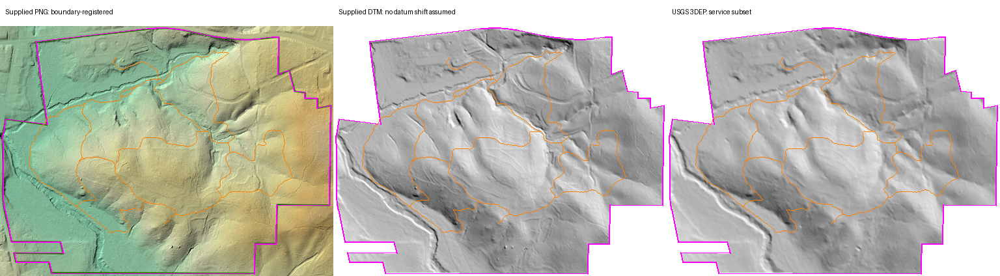

# Two-source 2D terrain (PR 4)

[PR 4 #32](https://github.com/ssomalinga3/CX_3803_JIDCC_6342_TSA/pull/32) follows [PR 3 #31](https://github.com/ssomalinga3/CX_3803_JIDCC_6342_TSA/pull/31)
and the [integration plan](../../docs/tasks/gis-data-integration-plan.md#8-pr-4-elevation-and-hillshade).
On November 12, 2026 the owner authorized approximate supplied terrain with its
uncertainty disclosed and requested a separate national public elevation option.
Neither source is approved survey/navigation data. 3D and trail ascent remain outside this slice.

## Source options and publication

| Catalog ID                 | Name                     |                                   Features | Source                              |
| -------------------------- | ------------------------ | -----------------------------------------: | ----------------------------------- |
| `cascade-terrain-supplied` | Elevation · supplied DTM | 28 elevation bands + 1 hillshade footprint | Preserved AIG `CSNP/csnp_dtm_2015/` |
| `cascade-terrain-usgs`     | Elevation · USGS 3DEP    | 32 elevation bands + 1 hillshade footprint | Preserved national service subset   |

Each `terrain` catalog layer contains Polygon features with `feature_kind`
`elevation_band` or `hillshade`. The chooser groups both sources into one
**Elevation** switch and a source dropdown. Exactly one source supplies bands,
labels, hit testing and relief at a time. USGS is selected by default; if it is
unavailable, the supplied source is used. Turning elevation off remembers the
source. Selecting a source keeps the dropdown and its notes open; tap the source
button to collapse it. Source/switch edits apply on Done, cancel on Back and survive in-session
refresh. The default complete map shows eight layers/102 features; choosing the
supplied DTM shows eight/98, and disabling elevation leaves seven/69.
Trails, context, GPS and camera state retain their existing independent behavior.
Pillars remain null. The selected source import now owns **nine layers / 131
features** (69 prior features + 62 terrain features); it preserves the original
trail properties, including zero source `ELEV_GAIN`, without inventing ascent.

Names, chooser source text, feature elevation/source/reference fields and two
dedicated Disclaimers entries distinguish the options. Bands are labeled in
**US survey feet (ftUS)** with 20 ftUS intervals. Map labels appear at zoom 17;
details show the band range and NAVD88 reference. Trail/POI hits take priority
over elevation polygons. Terrain never contributes to the trail key.

## Reproduce, verify and import

Use the [locked GIS environment](README.md#reproduce-verification-and-inspection)
from the workspace root. Conversion and checks use committed inputs, without
Downloads or a network service. NumPy 2.5.4 is now an explicit development-only
dependency; all other GIS pins are unchanged.

```sh
uv run --locked --project tools/gis python tools/gis/convert_terrain.py
pnpm exec prettier --write data/cascade-springs-gis/terrain.geojson mobile/assets/terrain/terrain-assets.json
uv run --locked --project tools/gis python tools/gis/convert_terrain.py --check
uv run --locked --project tools/gis python -m unittest discover -s tools/gis -p 'test_*.py'
# Refresh durable evidence only after reviewing changed inputs/controls:
uv run --locked --project tools/gis python tools/gis/convert_terrain.py --check --evidence
node --expose-gc tools/gis/measure_terrain.mjs
pnpm --dir backend db:import:terrain
pnpm --dir backend db:import:source
```

Set `CASCADE_DB_PORT` for the intended local database; `DATABASE_URL` overrides it.
`db:import:terrain` atomically replaces only the two terrain options.
`db:import:source` replaces all nine selected layers atomically. Both share
advisory lock `(6342, 2)` with trail/PDF/legacy-boundary writers. Replays remove
stale owned features; unrelated data remains intact. Old narrower commands do
not downgrade or remove terrain. The fresh database runner and CI replay these
commands and test public/private reads, bbox queries, mixed concurrency and rollback.
No migration, raster endpoint, storage service or native dependency is added.

## Datum, units and alignment

The AIG projection states GRS80 Transverse Mercator with central meridian
−84°10′, origin 30°, scale 0.9999 and false easting 700,000 metres. GDAL reads
its horizontal coordinates as US survey feet. `prj.adf` explicitly names
`NAVD88_height_(ftUS)`. Horizontal datum remains **unknown**: no NAD83/WGS84 EPSG
datum is assigned to the source. GDAL's projection reprojection makes a
ballpark/no-datum-shift assumption, authorized for approximate display only.
The conversion uses the exact ratio **1200/3937 metres per US survey foot**.
There is no vertical-datum transformation. The filename suggests 2015; it is not
an acquisition-date record. Additional decimal places do not establish accuracy.

`HillshadeCSNP.png` stays unchanged in the original ZIP. It has no world file.
[Controls](terrain-controls.json) identify eight fit corners and seven withheld
validation corners in the shared PDF boundary and the PNG. A full affine fit
maps pixels into Web Mercator; it does not use DTM image bounds. Maximum fit
residual is 0.925 m and maximum held-out residual is **1.145 m** in approximate
ground distance. Manual pixel placement and common cartography limit these
figures; they are not independent geodetic checks or a resolution of the DTM datum.

[The report](review/terrain-alignment.json) retains all pixel/target pairs,
residuals and affine coefficients. In the
[control image](review/hillshade-controls.png), red controls fit and blue controls
validate. The [comparison](review/terrain-comparison.png) places boundary and
supplied trails over registered original relief, regenerated DTM relief and
national relief. Shared ridges, gullies and creek/road structures support gross
alignment; they do not establish surveyed trail elevation.



At 155,454 common display samples, supplied-minus-USGS elevation has median
0.024 m and 5th–95th percentiles −0.207 to 0.327 m. This is **not** terrain-change
or accuracy evidence: source vintages, interpolation and possibly shared upstream
lidar can correlate the datasets. Source options are separately attributed;
they are not claimed to be independent surveys.

The central 90% of sampled differences therefore fall within about 13 inches,
much smaller than the map's 20 ftUS elevation bands. Similar band outlines,
colors and shading when switching sources are expected. A dedicated
“Why they look similar” note inside the expanded source dropdown explains this
agreement and the unconfirmed possibility of shared underlying survey data.
This explanatory note is not added to Disclaimers; the original detailed source
caveats remain there. The dropdown also shows concise source limitations.

The runtime uses regenerated gray relief, avoiding the original PNG's baked-in
green boundary, coloration and surrounding context. Thus the original PNG is
used as registered comparison evidence; the AIG owns the published supplied
heights/relief. `info/` remains supporting Esri data, not another layer.

## National public elevation acquisition

[USGS 3DEP](https://www.usgs.gov/3d-elevation-program/) is the national public
source. The [USGS elevation service](https://elevation.nationalmap.gov/arcgis/rest/services/3DEPElevation/ImageServer)
provides a multi-resolution bare-earth mosaic. The preserved
[acquisition record](sources/usgs-3dep.json) contains the retrieval timestamp,
exact export/query URLs, full service metadata, spatially intersecting source
catalog, output extent, byte size and SHA-256 of [the GeoTIFF](sources/usgs-3dep.tif).
The source subset is 787,694 bytes, one float32 band, EPSG:3857, 512 × 384 cells,
nodata −999999, with valid heights about 248.76–315.66 metres in the export.
It is elevation data requested with raster function `None`, not a rendered RGB image.

[USGS CONUS DEM specifications](https://www.usgs.gov/faqs/what-projection-horizontal-datum-vertical-datum-and-resolution-a-usgs-digital-elevation-model)
document metre heights and NAVD88; named intersecting USGS records also state
NAVD88. The service output is resampled and does not establish native pixel
resolution or per-pixel acquisition date. The recorded 17 catalog intersections
include overviews and candidate datasets; they do not identify which source won
each pixel. Retrieval time and service publication time are not survey dates.
The general [USGS 1m collection](https://data.usgs.gov/datacatalog/data/USGS%3A77ae0551-c61e-4979-aedd-d797abdcde0e)
and [seamless collection](https://data.usgs.gov/datacatalog/data/USGS%3A4f34caac-f28f-4ea0-8d82-eafb2b8f9a5d)
document public-domain data; this does not settle redistribution rights of the
separate supplied archive.

To acquire a deliberate future revision:

```sh
uv run --locked --project tools/gis python tools/gis/fetch_national_elevation.py
```

This network-only command writes `.work/gis-data/usgs-acquisition/` and never
overwrites committed source evidence. Review the GeoTIFF, metadata, source
catalog, hashes and alignment before explicitly replacing `sources/usgs-3dep.*`,
regenerating all assets/features and releasing their metadata together. A live
service request may differ or time out; normal builds never call it. The original
three-input manifest remains unchanged; this supplemental TIFF is verified
against its separate acquisition record by the terrain converter and CI.

## Bounded assets and API contract

GDAL reads the grid using existing AIG/raster libraries and bounded warp/cache
buffers. The original 7.34 million samples never become a JavaScript object
graph or a public response. Each source is bilinearly sampled into a 512 × 384
Web Mercator relief and a 256 × 192 band grid. A 45° azimuth / 45° altitude light models relief;
Web Mercator cell spacing is corrected to approximate ground metres locally.
Missing values/neighbors are transparent. Bands use valid cells only, polygonize
20 ftUS classes, simplify at 2 projected metres, clip to the PDF boundary and omit
components smaller than 16 projected square metres. Holes remain holes. These
are generalized display bands, not exact contour lines or point measurements.

Projected sampling bounds are canonicalized to one micrometre before hashing or
warping, avoiding platform floating-point changes to the dataset identity.
Reproduction checks require exact geometry, properties, placement and decoded
RGBA pixels. PNG compression bytes can differ across platforms; the committed
PNG must still match its exact published hash/size. An x86 Linux container with
the same locked GIS libraries reproduces the macOS geometry and pixels exactly.

The two PNGs and [descriptor](../../mobile/assets/terrain/terrain-assets.json)
are bundled in mobile. GeoJSON `hillshade` polygons are non-painted image
footprints. Their dataset version, key, image hash and exact ordered corner
coordinates must match the local descriptor; bands carry the same dataset
version/source hash. Unknown/stale/missing assets reject the whole load and use
the existing unavailable/retry state. Runtime never follows arbitrary raster
URLs from feature properties. The API stays GeoJSON-only with existing
public-read authorization and 60-second freshness; `data/` is not publicly served.

Publish the app assets and selected metadata as one coordinated dataset revision.
An older app cannot render a newer terrain revision until updated. Bundled bytes
do not establish an offline GIS snapshot: catalog visibility/metadata are still
network-loaded, switches stay session-only and no durable cache is introduced.
Worker and Node runtime builds do not contain source rasters or GIS libraries;
the import CLI reads committed files during data preparation.

Current assets: terrain GeoJSON 469,759 bytes formatted / 324,996 bytes compact;
PNGs 161,015 + 126,348 bytes (287,363 total); decoded RGBA 1,572,864 bytes total.
The converter rejects more than 600 KB serialized compact-style data or 300 KB
combined PNG bytes. Node 24.21.0 measured approximately 0.7–0.8 ms median parse
and 730 KB immediate heap allocation on this workstation. This excludes native
geometry copies, textures and rendering; it is not a device performance budget.

## Verification and handoff

Automated evidence covers original/supplemental source integrity, deterministic
conversion, withheld registration controls, feet/metres, nodata warp/alpha/holes,
bounded assets, both source memberships, atomic import/concurrent replay,
rollback, bbox/private reads, bundled-version rejection, details, switches,
camera preservation, existing GPS and trail behavior. Final execution results,
native screenshots and remaining checks are recorded in the
[PR 4 completion record](../../docs/tasks/gis-data-integration-plan.md#pr-4-completion-record).

Next: PR 5 starts from `gis/04-terrain` and adds only recoverable approximate
cell-signal observations. Preserve both terrain source IDs/versions, shared
source lock and all nine existing selected layers. Do not use terrain extent as
the signal screenshot's registration. Field accuracy, supplied horizontal datum,
source archive licensing, safety approval, durable offline behavior and 3D remain open.
