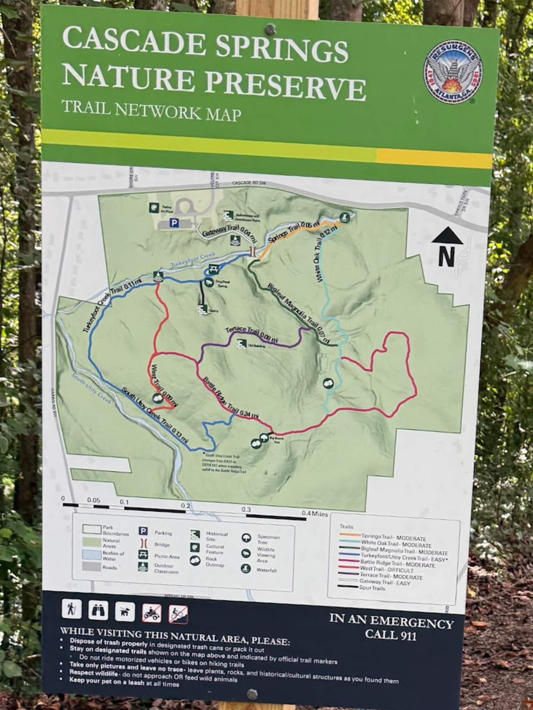

# Trail network reference and GIS structure

The project owner supplied this sign photo on November 4, 2026 as the intended
future map-content reference. Figma continues to govern application layout and
interactions; the sign guides trail identity, colors, labels, landmark symbols,
background context and legend content.

The original photo is retained as a design/source reference. Its perspective,
scale and terrain artwork are not georeferenced. GIS for this full network will
be supplied later. Do not trace coordinates, infer protective zones, or treat the
previously downloaded My Maps route as all named trails on this sign.

**Subsequent owner authorization, November 4, 2026:** best-effort splitting and
names on the existing partial route are now authorized. The
[reviewed section mapping](../../data/cascade-springs/README.md#approximate-trail-sections)
assigns seven approximate identities without changing coordinates; ambiguous
connections remain unnamed. This does not replace the full-network GIS request.

## Inventory and arrival status

**Current arrival status:** PR 2 integrates supplied trail segments; PR 3
extracts PDF boundaries, water, natural areas, roads, buildings and landmark
symbols. The [catalog](../../data/trail-network/catalog.json) records delivered
families and source counts without publishing placeholders. Sign difficulty/color
values below remain reference evidence. The owner kept difficulty unchanged;
see [PDF map policy and evidence](../../data/cascade-springs-gis/PDF-MAP.md).
Terrain and cell-signal integration remain pending.

The catalog is a planning/reference inventory, not a seed, GeoJSON collection
or API catalog.

| Trail / route family | Sign difficulty | Sign color reference |
| --- | --- | --- |
| Springs Trail | Moderate | Orange |
| White Oak Trail | Moderate | Light blue |
| Bigleaf Magnolia Trail | Moderate | Dark green |
| Turkeyfoot/Utoy Creek Trail | Easy, with an asterisk | Blue |
| Battle Ridge Trail | Moderate | Pink |
| West Trail | Difficult | Red |
| Terrace Trail | Moderate | Purple |
| Gateway Trail | Easy | White |
| Spur Trails | Not specified | Black |

Names and legend transcription require reconciliation with incoming GIS. The
sign also mentions a reroute; confirm its current route/conditions with the data
provider. Printed mileages are not loaded as measured geometry lengths. Colors
are descriptive references, not sampled production tokens.

Landmark categories cover parking, bridge, picnic area, outdoor classroom,
historical site, cultural feature, rock outcrop, specimen tree, wildlife viewing
area and waterfall. The catalog also accommodates trailhead, junction and spring
points from the existing downloaded source.

## Storage and exchange

The existing generic `gis_layer` and `gis_feature` tables support the reference:
SRID 4326 points/multipoints, lines/multilines and polygons/multipolygons; flexible
JSON properties; source metadata; public/private layer visibility; and GiST
spatial indexing. No new tables or nullable geometry placeholders are needed.
Use stable layer IDs and globally unique segment/feature IDs. Multiple trail
segments can share a `trail_id` for labels, styling and selection.

[Shared TypeScript attributes](../../backend/src/modules/gis/trail-network.ts)
define the incoming data structure below. These are types and geometry-family
metadata for future ingestion, not a new endpoint or an automatic importer.
Future importers must validate coordinates and these attributes at runtime;
PostGIS still enforces valid, nonempty SRID 4326 geometry. Existing demo/source
properties remain compatible and are not retroactively reclassified.

| Feature kind | Geometry | Additional properties |
| --- | --- | --- |
| `trail` | LineString / MultiLineString | Optional `trail_id` (absent on unnamed source segments); optional `difficulty` (`easy`, `moderate`, `difficult`), hex `color`, `length_m`, `surface_type` |
| `boundary` | Polygon / MultiPolygon | `boundary_kind`: `preserve` or `protective` |
| `landmark` | Point / MultiPoint | `landmark_kind` from the catalog |
| `water` | LineString / MultiLineString / Polygon / MultiPolygon | `water_kind`: `stream` or `water_body` |
| `natural_area` | Polygon / MultiPolygon | Common properties |
| `road` | LineString / MultiLineString / Polygon / MultiPolygon | Common properties; PDF roads are footprints |
| `building` | Polygon / MultiPolygon | Common properties; PDF building group |

All features carry `name` and `feature_kind`, with optional plain-text
`description` and `source_url`. Missing difficulty, surface, color or measured
length stays absent. Preserve original source fields separately when needed;
confirm source CRS, field mapping, publication permissions and provenance before
import. `cultural_feature` is a landmark category, not a fifth sustainability
pillar. Pillar assignments and protected-layer access remain D-05/D-02 decisions.

## Rendering when GIS arrives

Render natural areas/water and roads as context, preserve/protective boundaries
with distinguishable outlines, named trail strokes above background fills, and
landmark labels above trails. PR 3 keeps marker circles beneath trail strokes so
the network remains legible; point hit priority is retained. Trail colors identify routes; difficulty
uses text as well as any visual treatment. White Gateway Trail needs a contrasting
casing. Keep legend colors/symbols and feature details consistent with displayed
features; show unknown difficulty as unknown rather than easy.

The current renderer provides generic polygon/point styling, collision-managed
names and sign-inspired colors for identified trail sections, with an
approximate-name notice for derived source sections. A compact, horizontally
scrollable trail legend lists only identities present in the loaded line features. Category-specific
symbols, separate polygon treatments, layer selection and feature details remain
future UI work. Device offline downloads and trail-safety calculations remain
separate work.

## Approximate trail display palette

The owner requested this color pass stacked on the approximate-name work, using
[PR #11's sign-color reference](https://github.com/ssomalinga3/CX_3803_JIDCC_6342_TSA/pull/11#issuecomment-6646425788).
These tokens approximate the sign's descriptive colors; they are not sampled or
provider-approved hex values. The shared mobile
[palette](../../mobile/src/constants/trail-colors.ts) drives route strokes and
legend swatches together.

| Trail ID | Sign color | Display token |
| --- | --- | --- |
| `springs` | Orange | `#C95700` |
| `white-oak` | Light blue | `#73C6D5` |
| `bigleaf-magnolia` | Dark green | `#24533E` |
| `turkeyfoot-utoy-creek` | Blue | `#2864B4` |
| `battle-ridge` | Pink | `#D65388` |
| `west` | Red | `#C9363E` |
| `terrace` | Purple | `#78479B` |
| `gateway` | White | `#FFFFFF` |
| `spur` | Black | `#202020` |

Named lines must have `feature_kind: trail` and a recognized string `trail_id`
to receive a sign color. Both Gateway sections use white strokes with dark
`#444444` casing; other lines retain white casing. Explicitly unassigned
connections use dashed gray `#60646C`; other unknown/generic lines use solid gray
and the legend label “Other trails.” Bigleaf Magnolia and Spur tokens are ready
for future data but do not create geometry or legend rows in the current snapshot.
Names and accessible legend labels identify routes alongside color; absent
difficulty values stay absent.

The mobile client derives `_display_trail_*` properties on a separate render
collection. Input values for those keys are overwritten on line features.
Original geometry, API properties and snapshots remain unchanged; these local
properties are never written back to GIS. No migration, API contract change,
source re-import or native dependency/configuration change is required for this
color pass if the approximate-name sections are already imported.

## Acceptance when data is supplied

1. Reconcile each catalog entry with source IDs, route segments and current
   conditions; retain provider provenance and explicit publication visibility.
2. Validate geometry/CRS, attribute enums and units. Confirm segment topology,
   landmark alignment and preserve/protective polygons against provider evidence.
3. Import transactionally without duplicate IDs; keep incomplete/restricted data
   out of public responses. Unknown attributes must not become safety defaults.
4. Verify PostGIS → API → mobile property preservation, route colors/labels,
   readable trail overlap, landmark symbols, legend and independent layer toggles.
5. Verify fit/pan/zoom, denied location browsing and the agreed offline behavior
   on supported targets when those features are implemented. Field alignment and
   approved safety tolerances are required before claiming navigation safety.

## Structure verification — November 4, 2026

The fresh-database suite passes 47 backend tests, including a test-only round trip
through PostGIS/API for shared route IDs, optional difficulty, color, surface and
length attributes, both boundary kinds, landmark categories and multi-geometries
across the planned feature families. At that time, the inventory check confirmed all routes were
awaiting GIS and each planned layer matches the shared geometry contract. No
full-network geometry or renderer changes were introduced in that structure-only
verification. The later approximate-name slice is documented in the section
mapping above; full-network acceptance remains pending actual datasets.
