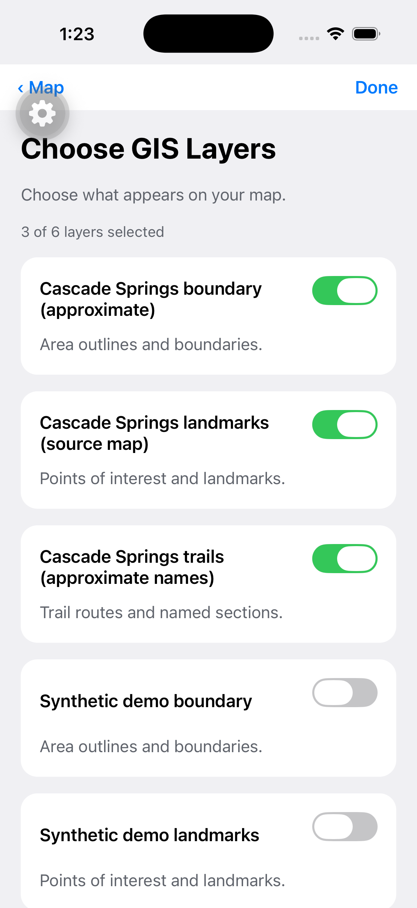
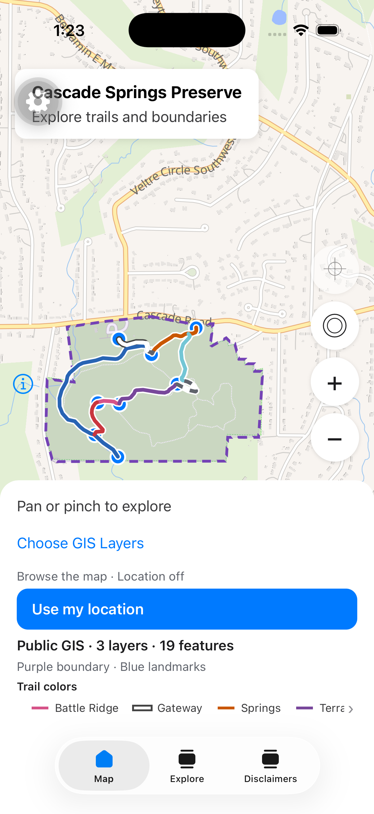

# Public GIS layer selection (J6-19)

Implemented against `main` at `2b75e0a` after pulling merged PRs #20–#25 on
November 5, 2026. [J6-19](https://gatech-team-f1s41wh9.atlassian.net/browse/J6-19)
remains In Progress pending review and acceptance; existing ownership is retained.
The [UI specification](../design/ui-spec.md#layer-selection-progress--november-5-2026)
and [acceptance paths](../design/user-flows.md#public-layer-selection-acceptance-j6-19)
define the behavior. No dependency, native configuration, API or schema change
is required.

**Current dataset:** PR 3 selects seven layers/69 features; the counts below are
historical verification evidence. See [PDF map integration](../../data/cascade-springs-gis/PDF-MAP.md).

The [current presets contract](layer-presets.md) supersedes the historical
draft/Done/Back interaction below: changes now apply immediately, the separate
Back button is removed, and Done only closes. Verification below records the
November 5 implementation.

## Historical behavior — November 5, 2026

- Map opens `/layers` above the existing tab group. Shared public GIS state keeps
  the map mounted and avoids a second catalog/feature request.
- Each public layer has a native switch, sanitized name and short type
  description. Only supplied Human/Social/Environmental/Economic badges appear.
- Done applies the draft. Back cancels it. Reopening shows applied choices;
  catalog replacement discards obsolete drafts. Applied choices survive retries
  within the session, with new IDs visible and unknown IDs ignored.
- Rendering, details hit-testing, counts and legend use the same visible subset.
  Original feature IDs/provenance remain intact. Re-enabling does not duplicate
  features or trail-key entries. Trails render above landmarks and boundaries.
- Applying visibility does not refit the camera or request GPS. All-off keeps
  basemap and location controls available. Map blur still pauses an enabled
  GPS session under the existing lifecycle policy.
- Choices are not persisted across full app restarts. Durable offline caching,
  the complete GIS inventory and performance budgets remain separate work.

## Local setup and data

Used the [local startup guide](local-startup.md) with Docker project
`cascade-springs-local`, PostGIS port 55434, Worker port 8787 and Metro port 8082.
Ran backend setup/migrations, demo seed, source import and the newly merged
`db:import:boundary`. Restarted the installed iOS development client against Metro;
JavaScript changes do not need a new native build.

The existing database retained three legacy demo layers because seed replay
does not delete unrelated records. It initially exposed six layers/24 features.
The simulator now selects the three source layers: ten trail sections, eight
landmarks and one approximate boundary (19 features). All three legacy demo
layers were hidden through the chooser. No GIS rows were deleted. A fresh seed
has only the demo boundary, so its catalog count can differ.

## Verification — November 5, 2026

- Mobile lint/typecheck and all **86 tests** passed. New coverage checks
  individual/combined/all-off filters, provenance and stable IDs, hidden hits,
  draft apply/cancel/reopen, catalog replacement, retry without lost choices,
  new/unknown IDs, no toggle fetch/GPS request, no visibility-driven camera
  refit, empty-catalog feedback, legend deduplication and overlay ordering.
- Fresh backend integration verification passed **73 tests** across migrations,
  replay/imports, access boundaries, bbox validation, local Worker HTTP and
  liveness/failure paths. No backend implementation was changed in this ticket.
- iPhone 17 Pro / iOS 26.3, installed development build: opened the dedicated
  screen, toggled source and legacy layers independently, cancelled with Map,
  applied/reopened choices, removed trails and their legend, hid everything,
  restored the three source layers and the legend. The basemap and zoom controls
  remained available throughout.
- With every GIS layer hidden, a synthetic route from the checked-in public
  fixture produced a fresh blue GPS position and enabled recentering. Returning
  from the chooser resumed the enabled session without another prompt. The
  synthetic route was then cleared and map location turned off.

The workspace `pnpm verify` passed: formatting, workspace lint/typecheck/tests
and both iOS/Android JavaScript exports. Its default backend run passes 57 tests
and skips 16 database integration cases; the separate fresh integration run above
executes all 73. Exports do not compile native apps or establish Android device
behavior.

Direct Figma retrieval was unavailable; this implementation follows the
previously documented screen hierarchy and visual direction. Exact Figma
measurements, large-font/VoiceOver checks, Android native behavior, cold-restart
offline availability, and numeric performance budgets remain unverified. The
current catalog has null pillars; the supported badge path is covered by a test
fixture rather than invented production assignments. See D-05/D-08/D-10 in
[open decisions](../decisions.md).

## Screenshots

The simulator developer-client gear is visible in these development screenshots.

