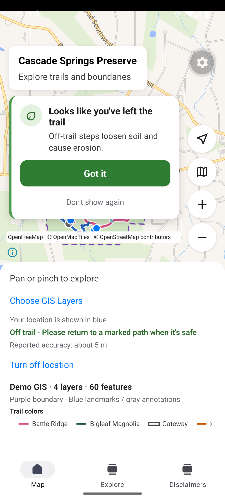

# Off-trail indicator (J6-25, with J6-24 detection)

[J6-25](https://gatech-team-f1s41wh9.atlassian.net/browse/J6-25) shows a friendly
reminder when a visitor appears to have left a marked trail.
[J6-24](https://gatech-team-f1s41wh9.atlassian.net/browse/J6-24) supplies the
jitter-buffered on/off-trail detection it depends on. Numeric tolerances are
**Proposed** engineering defaults pending D-05; they are not safety approval.

## Behavior

- **Where it runs:** entirely on the device (`mobile/src/data/off-trail.ts`,
  `mobile/src/hooks/use-off-trail.ts`). Visitor coordinates are never sent,
  stored or logged. The only persisted value is a boolean "don't show again"
  preference (`off-trail-warning.json` in the app's document directory).
- **Geometry:** all published `feature_kind: trail` lines and `boundary`
  polygons in the full public snapshot (live or cached offline). Hiding layers
  in Choose GIS Layers does not disable the check.
- **Preserve gate:** fixes outside the boundary polygons report `unknown`, so
  visitors on nearby streets or at home are never told they left a trail. With
  no boundary published, only fixes within 150 m of a trail are evaluated.
- **Jitter buffer (Proposed):**

  | Setting              | Value | Purpose                                         |
  | -------------------- | ----- | ----------------------------------------------- |
  | Enter off-trail      | 20 m  | Distance from nearest trail centerline          |
  | Return on-trail      | 12 m  | Lower exit threshold (hysteresis band 12–20 m)  |
  | Maximum fix accuracy | 25 m  | Poorer or unknown-accuracy fixes keep the state |
  | Consecutive fixes    | 3     | ≈3 s at the 1 s watch interval, both directions |

  Distances use a local equirectangular projection, accurate well under a meter
  at preserve scale. Any GPS gap (stale fix, map blur, backgrounding or location
  off) hides the indicator and restarts confirmation, but keeps the last
  confirmed assessment. A snapshot with no trail lines is treated the same way,
  since a fix cannot be assessed without trails. Replacing the live or cached GIS
  snapshot applies to the next fix without resetting the assessment.

- **UI:** a non-blocking card below the map header. The map, controls, dock and
  all active layers stay usable. **Got it** is the large primary action and
  receives screen-reader focus; it closes the card until the visitor returns to
  a trail (or leaves the preserve) and then leaves a trail again. Only a fresh
  fix ends a dismissal, so GPS gaps and GIS refreshes do not re-arm it, and a
  single fix near a trail cannot either. **Don't show again** is a quieter text
  button that stops the card on this device. While off-trail the dock also shows a subtle
  "Off trail" status line, independent of the card preference. The card yields
  to the feature-detail sheet.

## Tests

- `mobile/__tests__/off-trail.test.ts`: geometry extraction, known distances,
  preserve gate, single-fix jitter, hysteresis band, accuracy gate and a
  simulated walk (on trail → woods → back) using the supplied trail data.
- `mobile/__tests__/off-trail-warning.test.tsx`: map-screen integration for the
  card, focus, Got it re-arming, Don't show again persistence across restarts,
  dismissal across map blur/GIS refresh, a jittery fix after a GPS gap, leaving
  the preserve, stale-GPS confirmation restart in both directions, outside-preserve silence, stale/off location, and unchanged
  displayed layers.
- Positions come from `mobile/__tests__/fixtures/off-trail.ts`, derived from
  the committed supplied geometry rather than hard-coded coordinates.

## Manual simulator check

With the local stack running ([local startup](local-startup.md)), allow
location in the app, then move the simulated GPS with
`xcrun simctl location <udid> set <lat>,<lon>` or the
[walking panel](macos-android.md#walk-with-spoofed-gps). Known supplied-data
positions: on trail `33.7175748,-84.4796884`; about 40 m off trail inside the
preserve `33.7178406,-84.4791350`. Hold the off-trail position for at least
3 seconds.

## Verification record — November 19, 2026

Both platforms ran the same Metro (8083) against this checkout's local Worker
(8789) and Docker PostGIS (55436) with `db:seed`, `db:import:source`,
`db:import:trails` and `db:import:boundary`, confirmed by the app's
"Demo GIS · 4 layers · 60 features" summary and the Worker request log.

- **iOS:** `Cascade iOS 26` (iPhone 17, iOS 26.3), existing EAS development
  client; GPS moved with `xcrun simctl location` in ~2 m steps.
- **Android:** a separate `Cascade_API_36_J625` AVD (Pixel 7, Android 16 /
  API 36, Google APIs, arm64) with the existing development build; ports
  forwarded with `adb reverse`; GPS moved with `adb emu geo fix`.

Expo SDK 57 merges `mobile/.env.local` over the shell's `EXPO_PUBLIC_API_URL`.
To point a checkout at a non-default Worker, use a temporary, git-ignored
`mobile/.env.development.local` and restart Metro. The first iOS pass here
missed this and read another worktree's Worker; it was rerun against 8789.

| Check                                                 | iOS 26 | Android 16 |
| ----------------------------------------------------- | ------ | ---------- |
| On trail after enabling location: no card             | Pass   | Pass       |
| Walk ~40 m off trail: card plus "Off trail" dock line | Pass   | Pass       |
| Card clears the map control column                    | Pass   | Pass       |
| Got it closes card; dock line remains                 | Pass   | Pass       |
| Back on trail, then off again: card returns           | Pass   | Pass       |
| Got it survives a tab switch (GPS gap)                | Pass   | Not run    |
| Don't show again, relaunch, walk off: dock line only  | Pass   | Pass       |

The preference file read `{"version":1,"hidden":true}` on both platforms.

On Android, enabling location with Google Location Accuracy off made Play
services' accuracy dialog reopen after each decline, six times, before location
started. This is in the existing `useMapLocation` flow, not J6-25, and is
tracked separately.

Not verified: VoiceOver/TalkBack focus landing on **Got it** on a device
(covered by a Jest test only), physical-device GPS accuracy, and field
tolerance tuning (D-05).

React Compiler is enabled in the app but not in Jest. The hook's render-phase
update therefore compares only the location fix object, never derived geometry,
whose identity is not stable across compiler re-renders.
